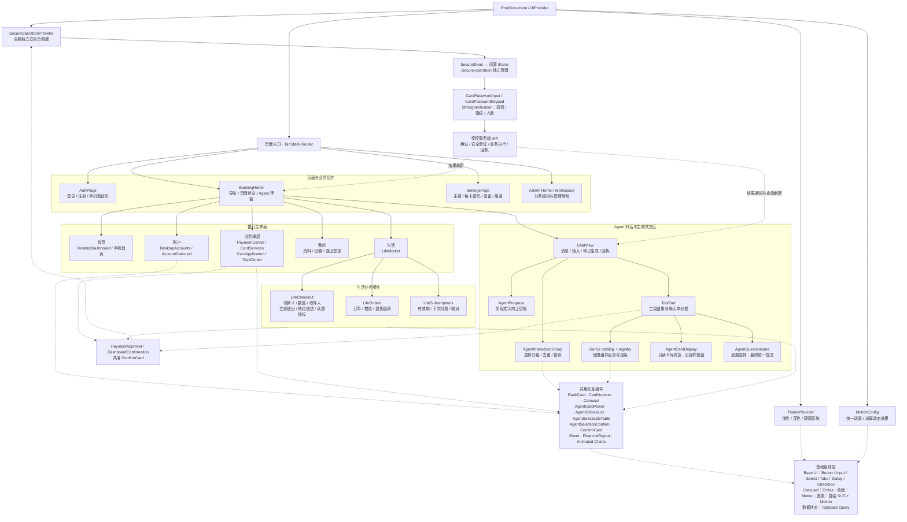
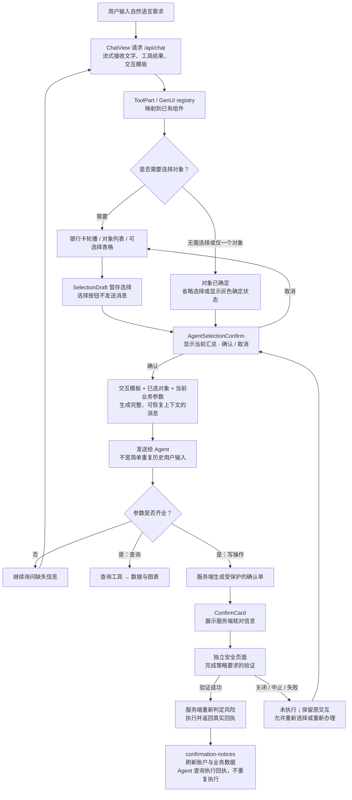
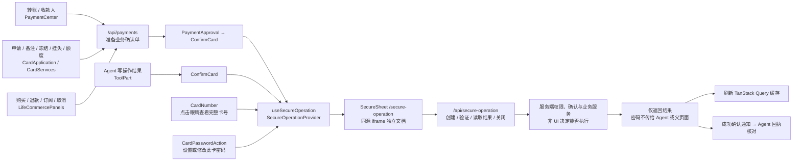

# UI 交互组件结构图

依据当前本地源码整理，日期：2026-10-16。图中的层级表示界面组织与职责；虚线表示复用、调用或状态通知，不表示所有组件都直接互相导入。

## 1. 整体结构

## 2. Agent 的选择与确认流程

两种“确认”职责不同：`AgentSelectionConfirm` 负责把业务选择提交给 Agent；`ConfirmCard` 负责核对服务端确认单并调用安全页。发送消息不等于授权交易。已完成或过期的确认单不能再次执行，可通过原卡片的“重新办理”入口生成新确认单。

交互消息相关文件：`src/components/chat/interaction-message.ts`、`selection-groups.ts`、`interaction-layout.ts`、`src/lib/agent-interaction-template.ts`。固定文案模板约束模型生成的字段；批量转账使用 `BatchTransferView` 保留每笔对象、金额及选择。

## 3. 原生业务与安全组件复用

安全页根据服务端返回的要求渲染所需验证。常规支付提供密码或可用替代方式；红色等级要求强验证；单笔超过3000元或收款账户异常的转账要求密码加指纹/人脸。指纹、人脸当前为显式演示验证，不代表真实生物识别。

## 4. 源码入口索引

| 职责 | 主要文件 |
| --- | --- |
| 应用外壳与全局 Provider | `src/routes/__root.tsx`、`src/components/ui/provider.tsx` |
| 主界面与响应式布局 | `src/components/banking/BankingHome.tsx`、`DesktopDashboard.tsx`、`DesktopAccounts.tsx` |
| 登录、注册与安全设置 | `src/components/banking/AuthPage.tsx`、`src/routes/login.tsx`、`register.tsx`、`settings.tsx` |
| 卡片与账单联动 | `src/components/banking/AccountCarousel.tsx`、`src/components/ui/BankCard.tsx`、`CardNumber.tsx` |
| 转账与卡片管理 | `src/components/banking/PaymentCenter.tsx`、`CardServices.tsx`、`DashboardConfirmation.tsx` |
| 生活商城与订阅 | `src/components/banking/LifeMarket.tsx`、`LifeCommercePanels.tsx`、`LifeProductArt.tsx` |
| 任务与自动授权展示 | `src/components/banking/TaskCenter.tsx`、`MandateList.tsx` |
| 对话、进度与工具呈现 | `src/components/chat/ChatView.tsx`、`ToolPart.tsx`、`AgentProgress.tsx`、`BatchTransferView.tsx` |
| 共用选择与确认 | `src/components/chat/AgentInteraction.tsx`、`ConfirmCard.tsx` |
| 只读银行卡与逐题问卷 | `src/components/chat/AgentCardDisplay.tsx`、`AgentQuestionnaire.tsx`、`display-purpose.ts`、`src/lib/questionnaire.ts` |
| 生成式组件白名单 | `src/genui/catalog.ts`、`registry.tsx` |
| 独立安全页及验证组件 | `src/components/ui/SecureOperation.tsx`、`SecureSheet.tsx`、`CardPasswordInput.tsx`、`StrongVerification.tsx`、`src/routes/secure-operation.tsx` |
| 基础组件、主题及动画 | `src/components/ui/`、`src/components/ThemeToggle.tsx`、`src/lib/theme.ts` |
| 查询、API 与回执通知 | `src/lib/queries.ts`、`src/lib/confirmation-notices.ts`、`src/routes/api/` |
| 管理后台 | `src/components/admin/Home.tsx`、`Workspace.tsx`、`ActionDialog.tsx`、`views/` |

首页、账户页的桌面布局与手机布局部分分开实现；银行卡、轮播、图表、Agent 选择、银行确认单及安全验证是跨页面复用的主要边界。生活订单与会员权益的配送模拟属于服务端业务逻辑，不由 UI 自行生成交易结果。
